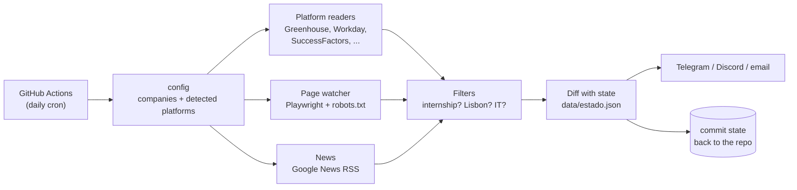

# Internship Watcher

[](https://github.com/guifigueiras/internship-watcher/actions/workflows/testes.yml)


A self-running Python tool that watches ~90 companies in the Lisbon area every day and
sends me **only the new internship openings** on Telegram, plus a weekly status report
every Friday. It runs entirely on GitHub Actions, with no server and no AI model, so it keeps
working with no maintenance on my side.

I built it during my BSc in Computer Science and Engineering at Instituto Superior Técnico
to stop checking dozens of career pages by hand while looking for a summer internship.

## Example output

The format of a daily Telegram message (offers taken from a real run; the messages are in
Portuguese):

```
🆕 2 novidades (04/11/2026)

💼 Ofertas de estágio (2)

💻 Deloitte: Deloitte Tech Experience FY26/27 | New Graduates | Join Us
📍 Lisboa, PT +4 mais…
https://jobs.deloitte.pt/job/...

📌 REN: Estágio Académico
📍 Lisboa, PT
https://oportunidades.ren.pt/job/...

💻 parece informática · 📌 outra área ou por confirmar
```

💻 = looks like an IT role, 📌 = another area (still reported, since many companies run a single
internship programme for all degrees).

## Features

- **12 recruiting platforms** read through their public APIs or listings: Greenhouse, Lever,
  Workable, SmartRecruiters, Workday, Recruitee, Personio, Ashby, Teamtailor, Breezy,
  SAP SuccessFactors (RMK career sites) and Amazon Jobs.
- **Career-page watcher** for companies without a supported platform: renders the page in a
  real browser (Playwright), follows up to two promising sub-pages and reports
  internship-related text that was never seen before (e.g. "Summer Internship 2027").
- **Aggregators and news**: summer-internship listings (Talent Portugal), the university
  career centre, and Google News RSS searches, with a filter for sports news
  ("estágio" also means a team's training camp in Portuguese).
- **Filters**: is it an internship? (keyword rules with seniority exclusions), is it in the
  Lisbon area? (city/region matching), does it look like IT? (used only for the icon).
- **Novelty detection**: every item has a stable key; the state lives in a JSON file that the
  workflow commits back to the repository after each run.
- **Weekly report**: what is open right now, pages saying "applications open", the week's
  totals, and which sources are failing. It also works as a heartbeat: if it doesn't arrive on
  Friday, something stopped.
- **Auto-discovery**: a separate workflow visits each company's website and detects its careers
  page and recruiting platform from URL "signatures", then verifies them against the platform's API.

## How it works



1. `config.py` merges the hand-written company list with the output of the detector
   (hand-written values always win).
2. `leitores.py` has one reader per platform, all with the same signature
   `reader(session, id, source) -> list[Offer]`, so the main loop doesn't care which platform
   it is talking to. Readers run in parallel (8 threads).
3. If a reader decides the configuration is wrong (e.g. a site that isn't really a
   SuccessFactors career site), it raises `NaoSuportado` and the company falls back to the page
   watcher instead of failing every day.
4. `estado.py` compares each item's key with the stored state. The state is saved **only after
   the message is sent**, so a failed send is retried on the next run.

## Design decisions

- **State in the repository instead of a database.** GitHub Actions starts every run on an
  empty machine; a JSON file committed by the workflow is the simplest durable storage that
  costs nothing and is easy to inspect.
- **"First read" vs "new".** When a source is read successfully for the first time, or when its
  configuration changes (each source stores a signature of its config), whatever is already
  there is shown as "already visible" rather than as news. This removed a whole class of
  false alerts after fixing a misconfigured source.
- **Fail soft, report loudly.** One broken source never stops the others; each source tracks its
  consecutive failures and is reported after 3 in a row, and again in the weekly report.
- **Being a good citizen.** The page watcher respects `robots.txt`, visits at most three pages per
  company per day and skips images and fonts. Sites that forbid bots (or require login, such as
  LinkedIn) are covered only through news and their own email alerts.
- **No AI at runtime**, on purpose: the tool has to keep running for free, with no API keys,
  for the whole recruiting season.

## Project structure

```
vigilante/
  main.py        entry point: collect → filter → diff → send → save
  leitores.py    one reader per recruiting platform
  paginas.py     career-page watcher (Playwright) and sitemap reader
  noticias.py    Google News RSS
  filtros.py     internship / location / IT classification
  estado.py      state: seen items, source health, run history
  semanal.py     Friday report
  detetor.py     discovers each company's careers page and platform
  notify.py      Telegram, Discord and email
  config.py, rede.py   configuration loading; HTTP with retries
config/          companies (hand-written), detected platforms, aggregators and news queries
tests/           84 tests with fake HTTP sessions (no network needed)
.github/workflows/   daily run, detector, tests on every push
```

Code comments and messages are in Portuguese (my native language); this README is in English.

## Running it yourself

1. Use this repository as a template (or fork it) and make your copy **private**.
2. Create a Telegram bot with @BotFather and add the secrets `TELEGRAM_TOKEN` and
   `TELEGRAM_CHAT_ID` (Settings → Secrets and variables → Actions). Discord and email are also
   supported.
3. Edit `config/empresas.yaml` and run the **Detector** workflow once.
4. Run the **Vigilante** workflow in `simulacao` mode (prints the message, sends nothing), then
   in `normal` mode.
5. To run it daily, add back the schedule in `.github/workflows/vigilante.yml`:
   ```yaml
   on:
     schedule:
       - cron: "23 7 * * *"
   ```

Locally:

```bash
pip install -r requirements.txt -r requirements-dev.txt
python -m playwright install chromium
python -m pytest                              # tests, no network needed
python -m vigilante.main --modo simulacao     # full run, prints the message only
```

## Limitations

- Keyword rules are not perfect: some messages include internships outside IT, and the page
  watcher can report minor wording changes. Ambiguous items are reported rather than hidden.
- Websites change; when a source breaks, the tool says so, but fixing it is manual.
- GitHub's scheduler is best-effort, so a daily run is occasionally skipped.

## Acknowledgements

Developed with the help of an AI assistant (Claude) for parts of the code; the requirements,
design decisions and fixes came from running it against the real sites and iterating on the results.

## License

MIT
